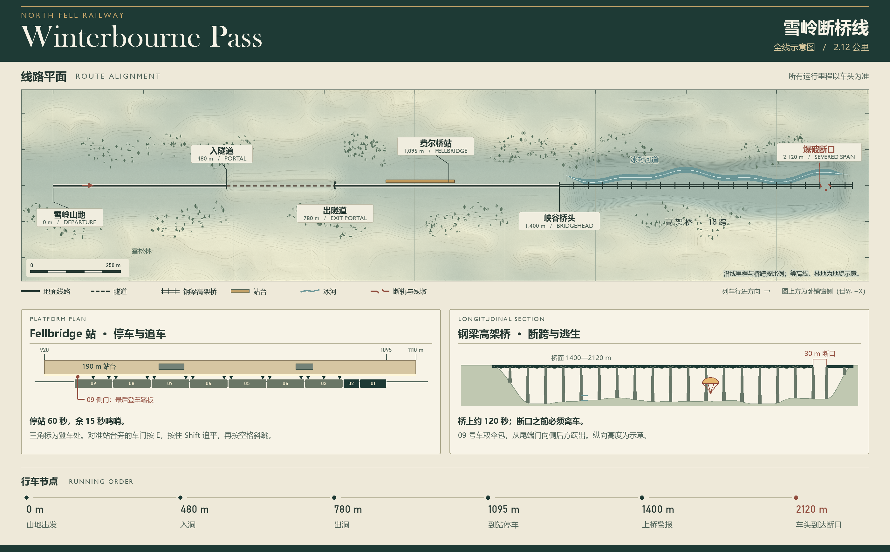
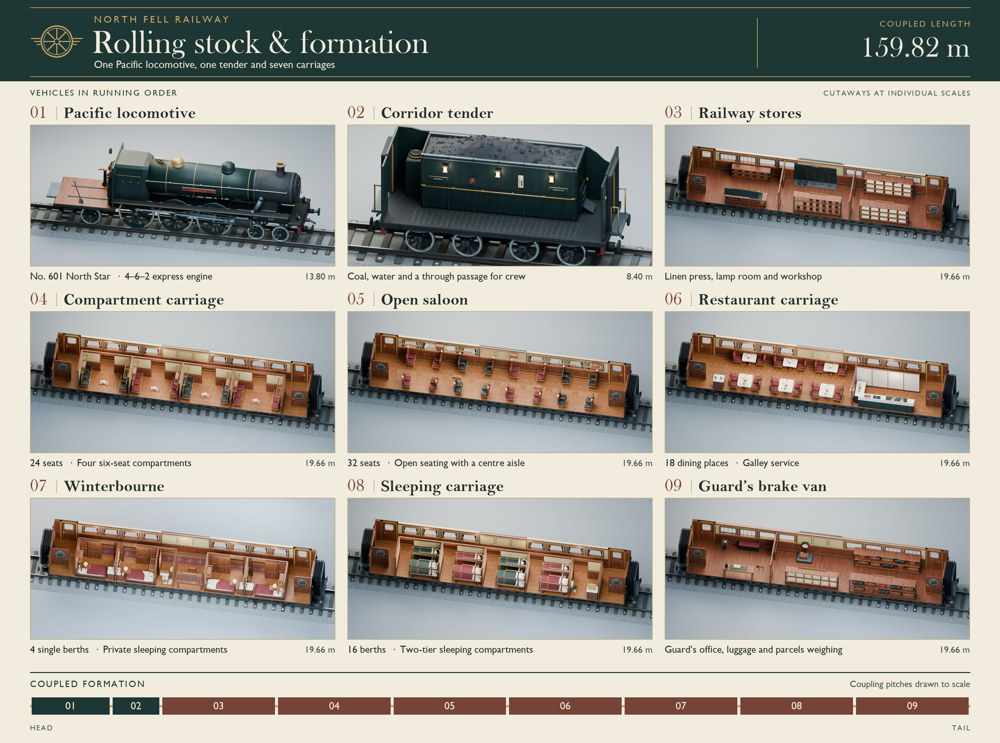
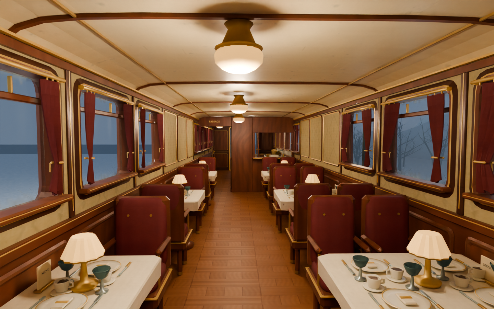

# Winterbourne 雪夜快车

一列虚构的 1930 年代英国北境夜车，往返于 London 和 Fellbridge。全列 **1 台蒸汽机车、1 辆煤水车、7 节车厢**，沿车钩对接平面计长 **159.82 米**。玩家在 07 号单人卧铺的床边出发，可以沿走廊步行到餐厅、座车、车尾值班室及机车驾驶室。

## 试玩雪岭断桥线

在 Unity 6 的 URP 工程中导入[完整资源包](Releases/Winterbourne.unitypackage)，打开 [WinterbournePass 场景](Assets/Transperceneige/Pass/WinterbournePass.unity)，点击 **Play**，再单击车厢画面启程。需要随时查看车辆模型时，可打开独立的 [WinterbourneExpress 自由参观场景](Assets/Transperceneige/Formation/Demo/WinterbourneExpress.unity)。



| 按键 | 操作 |
|---|---|
| WASD／方向键、鼠标 | 行走、观察。按住左或右 **Shift** 逐渐加速，松开减速。Esc 释放鼠标。 |
| E | 对准门扇、把手或门框拉手开关门。车内门随时可开；停稳后两侧外门解锁。发车时，仍在站台旁的那扇门可以重新打开。 |
| F、B | F 拾取物品，B 展开或收起八格背包。底部常显前四格；打开背包后依次点两格可以换位。 |
| 空格 | 原地跳、跑跳或斜跳。掉到站台下时，面向站台边缘按空格攀回去。在峡谷中，从已解锁的 09 号尾台向外跃出。 |
| L、R | L 在雪山黄昏、风雪白昼、暴雪深夜间切换。结局画面按 R 从最近的检查点重试。 |

列车沿 2.12 公里线路行驶。穿过 300 米长的山体隧道后，列车在 Fellbridge 的 190 米站台停靠 **60 秒**，最后 **15 秒**鸣哨。发车时若还在站上，先靠近任意一扇仍在站台边的门，**按 E 开门，按住 Shift 追平，按空格斜跳进门洞**。车门逐扇驶离站台后上锁，09 号亮灯侧踏板是最后的登车机会。错过末班踏板会失温。

在 **09 号行李车靠值班室的低层架子**上可以找到帆布跳伞包。上桥后，列车以约 6 米/秒驶向已炸断的桥跨，预警时间约 **120 秒**。等车尾悬在峡谷上方，到朝后的尾门按 E 开门，再到尾部平台按空格跳伞。背包的八个格子都可以装伞；携带时自动开伞，降落到谷底后通关。留在列车上或无伞坠落都有独立失败结局。停站前及上桥前自动记录检查点。

[卧铺窗外的黄昏](Previews/Pass/MountainDusk.png) · [白昼](Previews/Pass/MountainDay.png) · [深夜](Previews/Pass/MountainNight.png) · [山体隧道](Previews/Pass/Tunnel.png) · [站台](Previews/Pass/Platform.png) · [高架桥](Previews/Pass/Viaduct.png) · [断口](Previews/Pass/BrokenSpan.png)

窗景、机关和补给都能在该场景中编辑。移动 09 号车内的 `ParachutePack` 对象即可调整拾取点。重建关卡时，将 [Pass 编辑器脚本](Source/Pass/UnityEditor) 和编组编辑器脚本一起放入 URP 工程的 `Assets/Editor`，依次执行 `Winterbourne.Editor.PassBuild.Build` 和 `Winterbourne.Editor.PassBuild.Export`，并传入 `-formationRoot "<仓库绝对路径>"`。



## 自由参观九节车辆

1. 在使用通用渲染管线（URP）的 Unity 6 工程里导入 [Winterbourne.unitypackage](Releases/Winterbourne.unitypackage)。整列编组和 07 号的共享资源都在包内。
2. 打开 [WinterbourneExpress 场景](Assets/Transperceneige/Formation/Demo/WinterbourneExpress.unity)，点击 **Play**，再单击游戏画面。
3. **WASD／方向键**移动，鼠标转动视角。对准包厢滑门按 **E** 开关。**Esc** 释放鼠标。

从床边走出包厢，转向编号较小的一端。穿过第一道车间接缝就是 **06 号餐厅**，三组双人桌和四人桌共 18 席。沿传菜口旁的乘客侧廊继续前行，可以绕过炉灶和洗碗池，到达 **05 号开放座车**。32 位旅客是按座位摆放的静态人物；在 05 号实例内切换 `Travellers` 对象可以查看空车。



## 车辆目录

每节车都有独立可编辑的 Blender 模型和 Unity 预制体。**内景**为 Unity 玩家相机拍摄；**剖视**为同一模型拆去近侧墙板与顶棚后的 Blender 渲染。

| 编号 | 车辆及可探索空间 | 源模型 | 游戏资产 | 预览 |
|---|---|---|---|---|
| 01 | **North Star 蒸汽机车** · 4–6–2 轴式，司机与司炉的站位、压力表、水位计、制动台、火箱门 | [Blender](Source/Formation/Car01.blend) | [预制体](Assets/Transperceneige/Formation/Prefabs/Car01.prefab) | [内景](Previews/Formation/Car01_Interior.png) · [剖视](Previews/Formation/Car01_Cutaway.png) |
| 02 | **走廊式煤水车** · 八轮底架、煤仓、水柜、受护侧廊，前部通往机车踏板 | [Blender](Source/Formation/Car02.blend) | [预制体](Assets/Transperceneige/Formation/Prefabs/Car02.prefab) | [内景](Previews/Formation/Car02_Interior.png) · [剖视](Previews/Formation/Car02_Cutaway.png) |
| 03 | **勤务备品车** · 布草架、湿工具柜、信号灯架、钳工台与备件箱 | [Blender](Source/Formation/Car03.blend) | [预制体](Assets/Transperceneige/Formation/Prefabs/Car03.prefab) | [内景](Previews/Formation/Car03_Interior.png) · [剖视](Previews/Formation/Car03_Cutaway.png) |
| 04 | **包厢座车** · 四间六人包厢、相对的长椅、侧廊及四扇滑门，共 24 席 | [Blender](Source/Formation/Car04.blend) | [预制体](Assets/Transperceneige/Formation/Prefabs/Car04.prefab) | [内景](Previews/Formation/Car04_Interior.png) · [关门后的视线](Previews/Formation/Car04_DoorWindow.png) · [剖视](Previews/Formation/Car04_Cutaway.png) |
| 05 | **开放式座车** · 八排 2＋2、贯通中廊、上方行李架及 32 名可隐藏的旅客 | [Blender](Source/Formation/Car05.blend) | [预制体](Assets/Transperceneige/Formation/Prefabs/Car05.prefab) | [内景](Previews/Formation/Car05_Interior.png) · [剖视](Previews/Formation/Car05_Cutaway.png) |
| 06 | **带厨房餐车** · 18 套餐具、桌灯、餐具柜、传菜口、独立乘客通道与 L 形厨房 | [Blender](Source/Formation/Car06.blend) | [预制体](Assets/Transperceneige/Formation/Prefabs/Car06.prefab) | [内景](Previews/Formation/Car06_Interior.png) · [厨房](Previews/Formation/Car06_Galley.png) · [剖视](Previews/Formation/Car06_Cutaway.png) |
| 07 | **Winterbourne 头等卧铺** · 四间单人包厢、窗边桌灯、写字台与独立卫生间 | [Blender](Source/Car07/Car07.blend) | [预制体](Assets/Transperceneige/Car07/Car07.prefab) | [内景](Previews/Formation/Car07_Interior.png) · [剖视](Previews/Car07_Cutaway.png) |
| 08 | **普通卧铺车** · 四间四铺包厢，共 16 铺，含铺帘、爬梯、编号和共用盥洗室 | [Blender](Source/Formation/Car08.blend) | [预制体](Assets/Transperceneige/Formation/Prefabs/Car08.prefab) | [内景](Previews/Formation/Car08_Interior.png) · [剖视](Previews/Formation/Car08_Cutaway.png) |
| 09 | **列车员及行李车** · 托运行李架、挂签皮箱、包裹秤、值班日志、信号旗与手制动轮 | [Blender](Source/Formation/Car09.blend) | [预制体](Assets/Transperceneige/Formation/Prefabs/Car09.prefab) | [内景](Previews/Formation/Car09_Interior.png) · [剖视](Previews/Formation/Car09_Cutaway.png) |

## 编组和编辑

Unity 中 Y 向上、Z 沿车长向车尾，原点位于各车轨面；07 号在演示场景的世界原点。拼接时将前车的 `Socket_B` 与后车的 `Socket_A` 重合。01、02 的对接间距分别为 13.80、8.40 米，03 至 09 每节为 19.66 米。每辆车的功能区、轮轴和车身均保有可编辑的网格分组。漫游场景使用静态列车，机车仪表、手制动轮等按陈设建模。

直接打开上表中的 Blender 5 源文件即可编辑。材质贴图已内嵌，各新增车辆均保存了车内相机与实际灯位。[FBX 目录](Assets/Transperceneige/Formation/Models) · [机车外观](Previews/Formation/Car01_Pacific.png) · [07 号独立资源包](Releases/Car07.unitypackage)

在仓库根目录用 Blender 后台重建新增车辆。可按需只生成一节或一批。

```sh
blender -b --factory-startup --python-exit-code 1 -P Source/Formation/Build/build.py -- --cars 6,5 --photos
```

[建模生成器](Source/Formation/Build/build.py) 同时输出模型、FBX 和以 Unity 米制坐标表示的[碰撞、灯光、相机与路线数据](Source/Formation/Layouts)。[Unity 编辑器工具](Source/Formation/UnityEditor) 用于重建整车预制体及漫游场景。07 号另保有原始[建模脚本](Source/Car07/Build/build.py)和[独立漫游场景](Assets/Transperceneige/Car07/Demo/Car07_Walkthrough.unity)。

需要重打资源包时，将仓库的 `Assets/Transperceneige` 连同 .meta 文件复制到 Unity 6 URP 工程，将上述三个编辑器脚本放入该工程的 `Assets/Editor`，在该工程中运行 `-executeMethod Winterbourne.Editor.FleetImport.Build -formationRoot "<仓库绝对路径>"`。生成的完整包写入仓库的 `Releases` 目录。

## 实物参考

- *Fingall* 普尔曼餐车的木饰、餐厅与厨房。[Bluebell Railway](https://www.bluebell-railway.co.uk/bluebell/pics/car_fingall.html)
- 1928 年英国三等卧铺车及不同票级的卧铺服务。[Science Museum Group](https://collection.sciencemuseumgroup.org.uk/objects/co205844/london-midland-scottish-railway-sleeping-car)
- 1928 年走廊式煤水车及乘务人员通往驾驶室的通道。[Sir Nigel Gresley Locomotive Trust](https://www.sirnigelgresley.org.uk/chime-archive/mob-tenders1.shtml)
