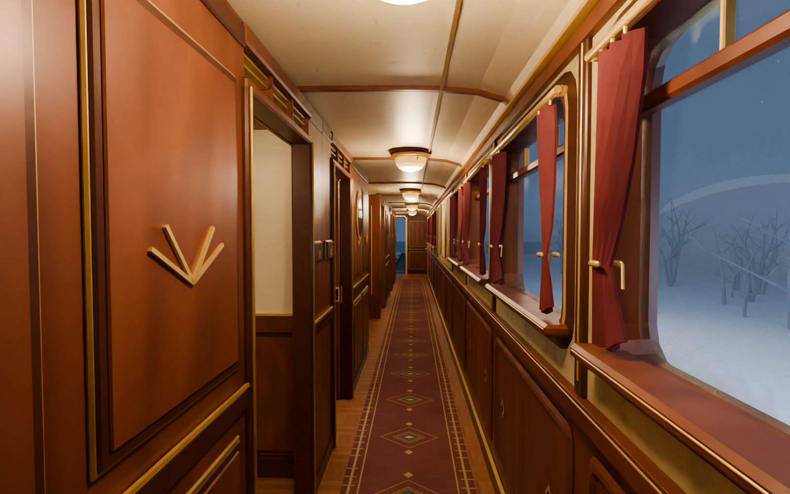
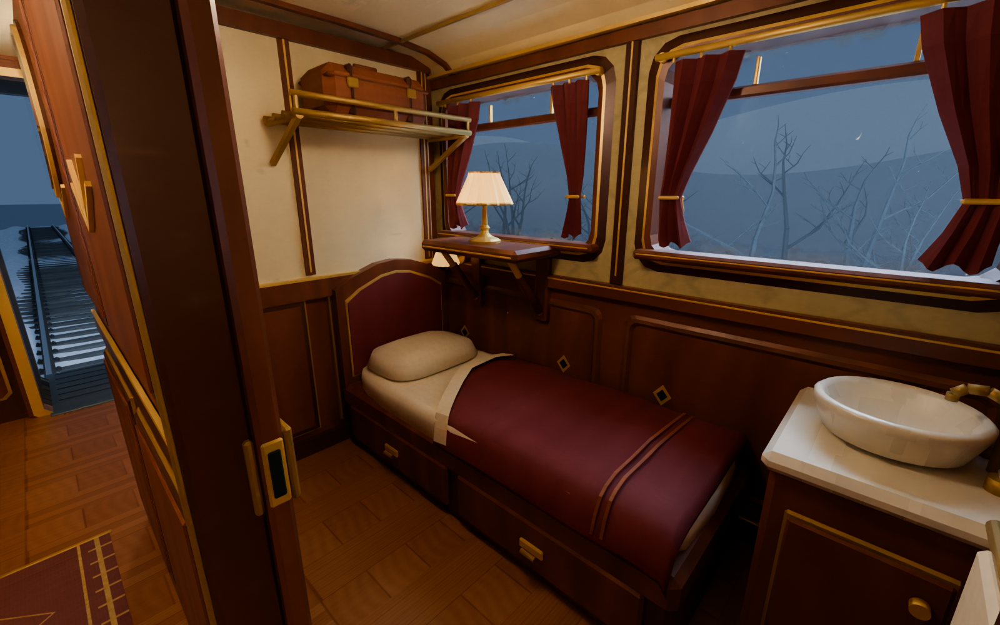
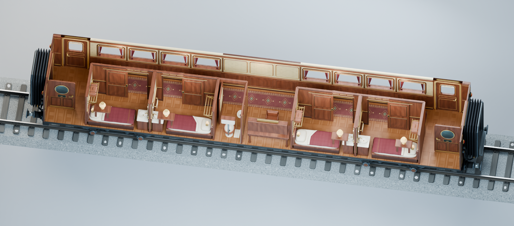
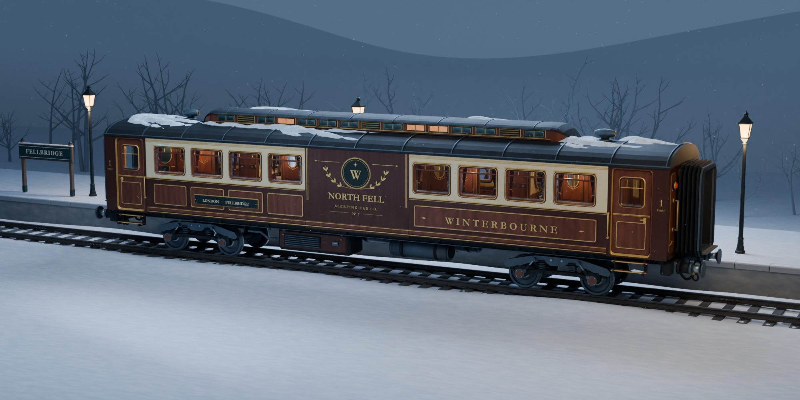

# Winterbourne · 07 号卧铺车

《Le Transperceneige》游戏的第一节可进入车厢。Winterbourne 是虚构的英国北境夜车，设计取材于两次大战之间的英式普尔曼车厢。蓝铃铁路保存的 1924 年 *Fingall* 号为车内木镶嵌工艺提供了参考。[Bluebell Railway 馆藏说明](https://www.bluebell-railway.co.uk/bluebell/pics/car_fingall.html)



## 走进车厢

1. 在使用通用渲染管线（URP）的 Unity 6 工程中导入 [Car07.unitypackage](Releases/Car07.unitypackage)。
2. 打开 [Car07_Walkthrough 漫游场景](Assets/Transperceneige/Car07/Demo/Car07_Walkthrough.unity)，点击 **Play**，再单击游戏画面。
3. 用 **WASD** 或方向键行走，移动鼠标观察。靠近包厢门，对准门扇按 **E** 开关，按 **Esc** 释放鼠标。

漫游场景已在 Unity 6000.2.10f1 和 URP 17.2 中验证。[查看 Unity 玩家相机实拍](Previews/Car07_Unity.png)

从任一端的贯通门进入，侧走廊依次经过四间单人卧铺包厢。每间配有床、窗边桌灯、盥洗盆、镜子和行李架。车厢中部设有乘务员书桌及独立卫生间。单车漫游时，走出端部过桥并跌落后会回到车内。[查看乘务员工作区](Previews/Car07_Bureau.png)



## 放进自己的场景

拖入 [Car07 预制体](Assets/Transperceneige/Car07/Car07.prefab)，即可使用车内灯光、碰撞体和四扇可交互滑门。漫游控制器位于 Demo 场景的玩家对象上。车体原点位于轨面中点，Unity 中 Y 轴向上，Z 轴沿车长。相邻车厢沿 Z 轴间隔 **19.66 m** 放置，两个端部过桥即相接。车钩处的对接点命名为 `Socket_A` 和 `Socket_B`。

车厢长 19.66 m、宽 3.47 m、高 4.62 m。Unity 导入后共 70 个网格、193,310 个三角面，窗玻璃与不透明车体分别使用独立材质。前后转向架、四组轮对、侧门和端门均保留独立枢轴。



## 编辑模型

[Blender 5 源文件](Source/Car07/Car07.blend) 已内嵌纹理。车顶与顶棚、行走部、外墙、走廊和包厢按集合组织。场景内设有走廊、包厢和书桌三个相机。Windows 下可用数字键盘 **0** 查看当前相机，**F12** 渲染。外部工程也可使用 [FBX](Assets/Transperceneige/Car07/Car07.fbx) 和同目录的 Textures。

从仓库根目录执行下列命令可重新生成 Blender 模型、FBX、纹理和预览图。

```sh
blender -b --factory-startup --python-exit-code 2 -P Source/Car07/Build/build.py -- --render
```



Fellbridge 站台、轨道和雪景属于展示布景。车厢预制体可独立放置在游戏自己的线路上。
