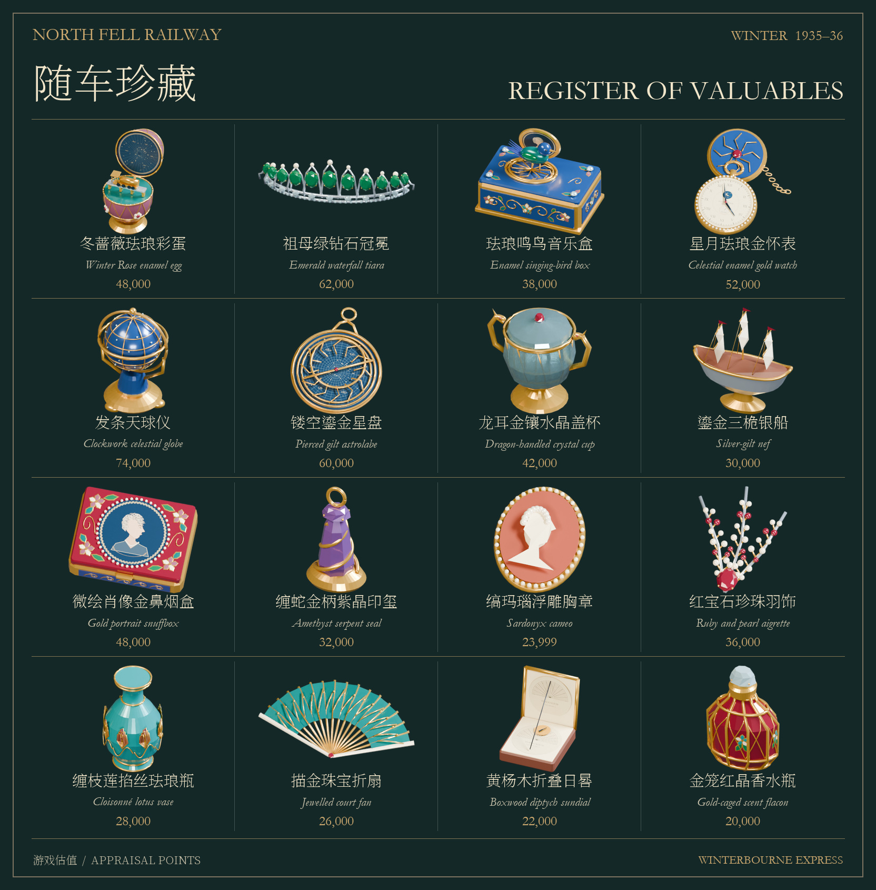

# Winterbourne 雪夜快车

一列虚构的 1930 年代英国北境夜车，往返于 London 和 Fellbridge。全列 **1 台蒸汽机车、1 辆煤水车、7 节车厢**，沿车钩对接平面计长 **235.80 米**。玩家在峡谷高架桥下的养护小屋开始，走入书柜传送门即可抵达 07 号卧铺床边，出生点旁的半开表盒里放着一块星月珐琅金怀表。拿起它，便可以向前去餐车和机车仪表室，或向后去找贵重行李与跳伞包。

## 试玩雪岭断桥线

在 Unity 6 的 URP 工程中导入[完整资源包](Releases/Winterbourne.unitypackage)，打开 [WinterbournePass 场景](Assets/Transperceneige/Pass/WinterbournePass.unity)，点击 **Play**，单击小屋画面行走。左前方的书柜是滑动盖门，固定的蓝色入口在右后方。对准书柜或把手按 **E** 可开合，走进露出的蓝光就到 07 号卧铺。需要随时查看车辆模型时，可打开独立的 [WinterbourneExpress 自由参观场景](Assets/Transperceneige/Formation/Demo/WinterbourneExpress.unity)。

游戏界面首次默认英文。小屋右上角、背包和开始画面的 **English / 中文** 按钮可立即切换语言。进入小屋立即开始 **12 分钟**整局倒计时。地点及停站、断桥时钟在左上，整局时钟与价值目标在顶端中央。底部血条开局为 **100**，背包和顶部共用携带价值。高处落地会按撞击速度扣血，生命值归零即死亡。搜到的藏品放入八格背包，顶部目标和背包估值同时更新。行走时按 **Esc** 释放鼠标。在小屋点 **End Game** 结算。时限内携带价值达到 **240,000** 才算撤离成功，低于目标显示失败。整局时限耗尽则死亡。结算画面上的 **New Game** 重开，**Quit** 退出。

## 1935 年冬季随车珍藏

在车上和 Fellbridge 站房可以找到 **16 种古董**。每趟重新分配藏放位置，45 个候选物品位置分布在 42 个可搜查处。站内寄存的珠宝、信桌边的印玺与车尾签封行李各有各的去处。这些藏品是为 1935 年夜车原创的私人托运品，金额使用游戏点数。



- **07 号卧铺**的写字台放着半开的绒面表盒。掀开的蓝珐琅表盖、金链和带月相的表盘，是第一件藏品的线索。对准怀表按 **F** 可获得 52,000。
- **05 号阅读厅和行李区**有一只日内瓦式珐琅鸣鸟盒。一只蓝绿羽色的小鸟立在镂花格栅上，身后支着椭圆形珐琅盖。其构造参考约 1820 年的瑞士自动鸣鸟音乐盒。[大都会艺术博物馆实物](https://www.metmuseum.org/art/collection/search/191140)
- **09 号行李车**的冬蔷薇珐琅彩蛋里藏了一列驶过高架桥的微型金色机车。开合蛋壳内藏微缩景物的构思取自 1901 年加特契纳宫彩蛋，原件内藏一座微型宫殿。[沃尔特斯艺术博物馆实物](https://art.thewalters.org/object/44.500/)
- **01 号司机仪表室**藏有价值 74,000 的发条天球仪。金色经纬圈、星标和子午环从不同方向包住钴蓝色天球。其他托运品还包括镂空鎏金星盘与缠枝莲掐丝珐琅瓶。[大都会艺术博物馆天球仪](https://www.metmuseum.org/art/collection/search/193606) · [星盘](https://www.metmuseum.org/art/collection/search/451699) · [莲纹珐琅器](https://www.metmuseum.org/art/collection/search/40633)

### 两条可实走的撤离路线

| 行程 | 一种达标装法 | 结算地点 |
|---|---|---|
| 07 → 06 → 05 → Fellbridge 行包间 | 金怀表 52,000、水晶盖杯 42,000、鸣鸟盒 38,000、肖像金鼻烟盒 48,000、祖母绿冠冕 62,000，共 **242,000**，用五格 | 穿过站房一楼书柜回小屋，点 **End Game**。 |
| 07 → 前部客车 → 08 → 09 → 峡谷 | 怀表、盖杯、鸣鸟盒，加紫晶印玺 32,000、珍珠羽饰 36,000、珐琅彩蛋 48,000，共 **248,000**。第七格放 09 号的伞包 | 从尾台跳出，在空中再按空格开伞，落地走回小屋结算。 |

每局均校验两条路线能在八格内达到 240,000。回读检查点时，背包、各实物位置和锁具状态一并恢复，整局时钟继续。Unity 6.6 实机分别走通了上述两种结算，携带 248,000 留在车上的玩家在断桥坠亡，携带 239,999 返回小屋则结算失败。

[开匣时的游戏画面](Previews/Pass/AntiqueCase.png) · [五件藏品入包后的游戏画面](Previews/Pass/AntiqueInventory.png) · [可编辑古董 Blender 总档](Source/Pass/TravellingValuables.blend) · [独立 FBX 和材质](Assets/Transperceneige/Pass/Valuables)

## 行车与操作

[书柜实机开合](Previews/Pass/BookcaseSlide.gif) · [可编辑的 Blender 书柜](Source/Pass/BookshelfPortal.blend) · [谷底回程门](Previews/Pass/LandingGate.png) · [小屋外门与雪地台阶](Previews/Pass/CottageEntrance.png) · [空中开伞提示实拍](Previews/Pass/FreefallPrompt.png)

书柜在前轨滑动 1.57 米。Blender 时间轴第 1 帧为开启，第 28 帧为关闭，书和柜体一同移动。


| 按键 | 操作 |
|---|---|
| WASD／方向键、鼠标 | 行走、观察。按住左或右 **Shift** 逐渐加速，松开减速。Esc 释放鼠标。 |
| E | 对准门扇、把手或门框拉手开关门。车内门随时可开；停稳后两侧外门解锁。发车时，仍在站台旁的那扇门可以重新打开。 |
| F、H、Esc | 对准实物按 **F** 拿取，对准柜、箱或抽屉按 **F** 搜查。有锁时，在标记区内再按 **F**。搜查面板中 **F** 拿选中一件，**H** 拿能装下的全部，**Esc** 收起。 |
| Tab／B、1–4 | 展开或收起八格背包，数字键切换前四个快捷格。需要腾位置时可选一格交换，换出的实物留在原搜点。伞包占一格，估值为零。 |
| 空格 | 跳跃。从过道朝 06 号餐桌移动，同时按空格可以跳上桌面。掉到站台下时，面向站台边缘按空格攀回去。在 09 号尾台按空格跃出，松开后在空中**再按一次空格开伞**，用 **WASD** 控制滑翔方向。 |
| 左／右 Ctrl | 按一下蹲下，再按一下站起。上方空间不足时保持蹲姿。 |
| R | 在结局画面从最近的检查点重试。 |

**03 号备品车和 09 号行李车**内设有通向车顶的梯子。走进 03 号的 **WORKSHOP** 工具间或 09 号的 **GUARD** 值班室，回头看门洞旁的铁梯。对准梯子按 **E** 爬上车顶，回到舱口按 **E** 下梯。车顶接近隧道时会出现提示。请在自己所在的车厢进洞前按 **Ctrl** 蹲下，等这节车驶出洞口再站起。站着撞上隧道顶会死亡，可以按 **R** 重试。

[09 号值班室内的铁梯](Previews/Pass/Van09RoofLadder.png) · [从车顶走板看隧道入口](Previews/Pass/RooftopTunnelApproach.png)

列车沿 2.12 公里线路行驶。穿过 300 米长的山体隧道后，列车在 Fellbridge 的 260 米站台停靠 **2 分钟**，最后 **15 秒**鸣哨。从穿过小屋书柜登车起，约 **3:35 到站、5:35 发车、7:18 上桥、8:01 车尾可跳、9:18 到达断口**。发车时若还在站上，先靠近任意一扇仍在站台边的门，**按 E 开门，按住 Shift 追平，按空格斜跳进门洞**。车门逐扇驶离站台后上锁，09 号亮灯侧踏板是最后的登车机会。留在站台错过最后一节车会失温。

站台后方的两层站房设在 **1935–1936 年冬季**。售票员从目的地票格取出编号硬卡票，在柜边的小压印机上盖好日期，再从木窗下递给旅客。行包间在侧门旁称重、系签、上架。上楼到值班桌前能看见职工时刻表和窗外列车。Fellbridge 使用虚构的 North Fell Railway 站名与印件，美术参考包括按 1937 年面貌复原的 Pickering、Haltwhistle 保存的售票隔墙、Chesterfield Central 的日期压印机，以及英国北部保存的候车室与行包秤。[Pickering 年代说明](https://www.nymr.co.uk/about/non-profit-organisation/) · [Haltwhistle 售票厅](https://tvcrp.org.uk/tvcrp-projects/378-bookinghall) · [日期压印机](https://collection.sciencemuseumgroup.org.uk/objects/co209722/ticket-dating-press-london-north-eastern-railway) · [Monkwearmouth 候车室](https://historicengland.org.uk/listing/the-list/list-entry/1209029) · [行包秤](https://www.nymr.co.uk/plan-your-visit/our-heritage-stations/pickering-station/pickering-station-trail/)

站房一楼的书柜可回桥下小屋，列车继续计时，背包和整局倒计时随行。只要车尾仍在站台旁，就能通过小屋书柜返回站长楼追车。若列车已离开，小屋里仍可选 **End Game / 结束游戏** 按实际携带价值结算。

在 **09 号行李车靠值班室的低层架子**上可以找到帆布跳伞包。上桥后，列车以约 6 米/秒驶向已炸断的桥跨，预警时间约 **120 秒**。等车尾悬在峡谷上方，到朝后的尾门按 E 开门，再到尾部平台按空格跃出。伞包放在八格中的任一格都可使用。**松开空格，在空中再按一次空格开伞，用 WASD 调整滑翔方向。** 未开伞直落或开伞过晚，落地时会按撞击速度扣血，生命值归零即死亡。安全着陆后可穿过落点旁的书柜，也可沿雪地走到小屋窗旁亮着灯的入口，按 **E** 开门进屋结算。停站前及上桥前自动记录检查点。

从小屋到峡谷谷底，列车行驶在同一个有流云的雪夜。07 号床边的月盘、雪坡与车顶受同一层云遮挡。车厢桌灯和站台暖灯在厚云经过时仍然亮着。实录前 38 秒从卧铺看雪岭，后 38 秒从站台看夜班站房。[Unity 月光实录](Previews/Pass/WinterbourneMoonlight.mp4) · [售票厅](Previews/Pass/FellbridgeBookingHall.png) · [候车室壁炉](Previews/Pass/FellbridgeHearth.png) · [二楼办公室](Previews/Pass/FellbridgeDutyRoom.png) · [站长室窗景](Previews/Pass/FellbridgeDutyWindow.png)

[售票窗与日期压印机](Previews/Pass/FellbridgeTicketWindow.png) · [行包间与机械秤](Previews/Pass/FellbridgeParcelsRoom.png) · [四件站房器物的可编辑 Blender 源文件](Source/Pass/FellbridgeHeritage.blend)

窗景、机关和补给都能在该场景中编辑。移动 09 号车内的 `ParachutePack` 对象即可调整拾取点。重建关卡时，将 [Pass 编辑器脚本](Source/Pass/UnityEditor) 和编组编辑器脚本一起放入 URP 工程的 `Assets/Editor`，依次执行 `Winterbourne.Editor.PassBuild.Build` 和 `Winterbourne.Editor.PassBuild.Export`，并传入 `-formationRoot "<仓库绝对路径>"`。


## 自由参观九节车辆

1. 在使用通用渲染管线（URP）的 Unity 6 工程里导入 [Winterbourne.unitypackage](Releases/Winterbourne.unitypackage)。整列编组和 07 号的共享资源都在包内。
2. 打开 [WinterbourneExpress 场景](Assets/Transperceneige/Formation/Demo/WinterbourneExpress.unity)，点击 **Play**，再单击游戏画面。
3. **WASD／方向键**移动，鼠标转动视角。对准包厢滑门按 **E** 开关。**Esc** 释放鼠标。

从床边走出包厢，转向编号较小的一端。穿过第一道车间接缝就是 **06 号餐厅**，三组双人桌和四人桌共 18 席。沿传菜口旁的乘客侧廊继续前行，可以绕过炉灶和洗碗池，到达 **05 号开放座车**。座车保留八排 2＋2 共 32 个空座，中央过道可通行。


## 车辆目录

每节车都有独立可编辑的 Blender 模型和 Unity 预制体。用关卡玩家的站立碰撞体在实际地板上以 10 厘米间隔测量，从两端通道可到达的室内面积逐辆达到原来的 **2.08–2.85 倍**。逐车报告记录了原面积、新面积和复测步骤。[逐车面积表](Source/Formation/Layouts/ReachableFloor.md)

**内景**取自 Unity 玩家相机。**剖视**展示同一模型拆去近侧墙板与顶棚后的布局。

| 编号 | 车辆及可探索空间 | 源模型 | 游戏资产 | 预览 |
|---|---|---|---|---|
| 01 | **North Star 蒸汽机车** · 4–6–2 轴式，司机与司炉的站位、压力表、水位计、制动台、火箱门，增设可绕行的司机仪表工作室 | [Blender](Source/Formation/Car01.blend) | [预制体](Assets/Transperceneige/Formation/Prefabs/Car01.prefab) | [内景](Previews/Formation/Car01_Interior.png) · [剖视](Previews/Formation/Car01_Cutaway.png) |
| 02 | **走廊式煤水车** · 八轮底架、煤仓、水柜、受护侧廊，前部通往机车踏板，两端有独立工具间 | [Blender](Source/Formation/Car02.blend) | [预制体](Assets/Transperceneige/Formation/Prefabs/Car02.prefab) | [内景](Previews/Formation/Car02_Interior.png) · [剖视](Previews/Formation/Car02_Cutaway.png) |
| 03 | **勤务备品车** · 布草架、湿工具柜、信号灯架、钳工台与备件箱，两端新设布草分发区和修理间 | [Blender](Source/Formation/Car03.blend) | [预制体](Assets/Transperceneige/Formation/Prefabs/Car03.prefab) | [内景](Previews/Formation/Car03_Interior.png) · [剖视](Previews/Formation/Car03_Cutaway.png) |
| 04 | **包厢座车** · 四间六人包厢、相对的长椅、侧廊及四扇滑门，共 24 席，另附通信写字间和会客室 | [Blender](Source/Formation/Car04.blend) | [预制体](Assets/Transperceneige/Formation/Prefabs/Car04.prefab) | [内景](Previews/Formation/Car04_Interior.png) · [关门后的视线](Previews/Formation/Car04_DoorWindow.png) · [剖视](Previews/Formation/Car04_Cutaway.png) |
| 05 | **开放式座车** · 八排 2＋2 共 32 个空座、中央过道，另设阅读桌及大件行李区 | [Blender](Source/Formation/Car05.blend) | [预制体](Assets/Transperceneige/Formation/Prefabs/Car05.prefab) | [内景](Previews/Formation/Car05_Interior.png) · [剖视](Previews/Formation/Car05_Cutaway.png) |
| 06 | **带厨房餐车** · 18 套餐具、桌灯、餐具柜、传菜口、独立乘客通道与 L 形厨房，另设银器间和私人餐厅 | [Blender](Source/Formation/Car06.blend) | [预制体](Assets/Transperceneige/Formation/Prefabs/Car06.prefab) | [内景](Previews/Formation/Car06_Interior.png) · [厨房](Previews/Formation/Car06_Galley.png) · [剖视](Previews/Formation/Car06_Cutaway.png) |
| 07 | **Winterbourne 头等卧铺** · 四间单人包厢、窗边桌灯、写字台与独立卫生间，增设晨间会客室与乘务布草间 | [Blender](Source/Car07/Car07.blend) | [预制体](Assets/Transperceneige/Car07/Car07.prefab) | [内景](Previews/Formation/Car07_Interior.png) · [剖视](Previews/Car07_Cutaway.png) |
| 08 | **普通卧铺车** · 四间四铺包厢，共 16 铺，含铺帘、爬梯、编号和共用盥洗室，另设旅客行李与布草周转区 | [Blender](Source/Formation/Car08.blend) | [预制体](Assets/Transperceneige/Formation/Prefabs/Car08.prefab) | [内景](Previews/Formation/Car08_Interior.png) · [剖视](Previews/Formation/Car08_Cutaway.png) |
| 09 | **列车员及行李车** · 托运行李架、挂签皮箱、包裹秤、值班日志、信号旗与手制动轮，增设贵重物托运间与分拣区 | [Blender](Source/Formation/Car09.blend) | [预制体](Assets/Transperceneige/Formation/Prefabs/Car09.prefab) | [内景](Previews/Formation/Car09_Interior.png) · [剖视](Previews/Formation/Car09_Cutaway.png) |

## 编组和编辑

Unity 中 Y 向上、Z 沿车长向车尾，原点位于各车轨面；07 号在演示场景的世界原点。拼接时将前车的 `Socket_B` 与后车的 `Socket_A` 重合。01、02 的对接间距分别为 18.00、12.00 米，03 至 09 每节为 29.40 米。每辆车的功能区、轮轴和车身均保有可编辑的网格分组。漫游场景使用静态列车，机车仪表、手制动轮等按陈设建模。

直接打开上表中的 Blender 5 源文件即可编辑。材质贴图已内嵌，各新增车辆均保存了车内相机与实际灯位。[FBX 目录](Assets/Transperceneige/Formation/Models) · [机车外观](Previews/Formation/Car01_Pacific.png) · [07 号独立资源包](Releases/Car07.unitypackage)

在仓库根目录用 Blender 后台重建新增车辆。可按需只生成一节或一批。

```sh
blender -b --factory-startup --python-exit-code 1 -P Source/Formation/Build/build.py -- --cars 6,5 --photos
```

[建模生成器](Source/Formation/Build/build.py) 同时输出模型、FBX 和以 Unity 米制坐标表示的[碰撞、灯光、相机与路线数据](Source/Formation/Layouts)。[Unity 编辑器工具](Source/Formation/UnityEditor) 用于重建整车预制体及漫游场景。07 号另保有原始[建模脚本](Source/Car07/Build/build.py)和[独立漫游场景](Assets/Transperceneige/Car07/Demo/Car07_Walkthrough.unity)。

需要重打资源包时，将仓库的 `Assets/Transperceneige` 连同 .meta 文件复制到 Unity 6 URP 工程，将编组及关卡编辑器脚本放入该工程的 `Assets/Editor`。依次执行 `Winterbourne.Editor.FleetImport.Build`、`Winterbourne.Editor.PassBuild.Build` 与 `Winterbourne.Editor.PassBuild.Export`，并传入 `-formationRoot "<仓库绝对路径>"`。生成的完整包写入仓库的 `Releases` 目录。

<details>
<summary>书柜木材纹理与生成提示</summary>

[胡桃木表面纹理](Assets/Transperceneige/Pass/Station/WeatheredWalnut.png) 使用内置 ImageGen 生成。纹理贴在独立建模的柜板、压线和柜门上，书籍及前后滑轨的形状由模型决定。原始纹理提示如下。

> Seamless tileable photogrammetry-style albedo texture, a single continuous planar surface of aged British ebonised walnut from a 1900 railway library bookcase, fills the entire square, orthographic direct overhead. Very subdued cool umber with desaturated brown in cut rays, satin-worn oil, subtle vertical wood grain running straight from bottom to top with occasional irregular arching fleck and fine old scratches. Fine grain visible and softly varied at being within 40 cm of historic joinery. Middle-low exposure but detail in shadows, average midtone about sRGB 95,79,68. NO planks or seams, NO beveled border, NO objects or lettering, NO directional light, NO bright knot or hole, NO dramatic black streaks. Flat, neutral illumination so the engine can light the material and physically texture tall carved vertical stiles and wooden book shelves in an abandoned Edwardian library.

</details>

## 实物参考

- *Fingall* 普尔曼餐车的木饰、餐厅与厨房。[Bluebell Railway](https://www.bluebell-railway.co.uk/bluebell/pics/car_fingall.html)
- 1928 年英国三等卧铺车及不同票级的卧铺服务。[Science Museum Group](https://collection.sciencemuseumgroup.org.uk/objects/co205844/london-midland-scottish-railway-sleeping-car)
- 1928 年走廊式煤水车及乘务人员通往驾驶室的通道。[Sir Nigel Gresley Locomotive Trust](https://www.sirnigelgresley.org.uk/chime-archive/mob-tenders1.shtml)
